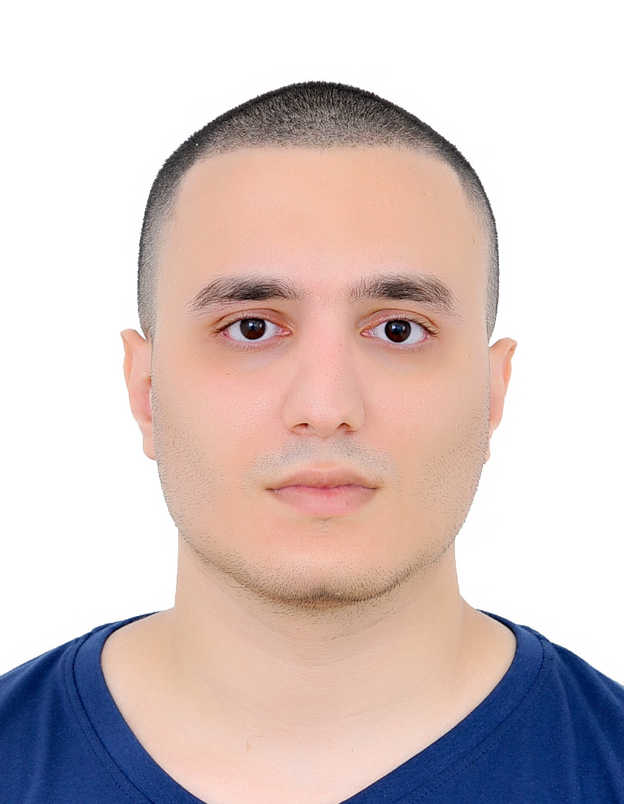

<!-- Header banner -->

  

[)](https://git.io/typing-svg)

---

## 👋 About Me

State Engineer in Computer Science (Software Engineering, Master's-level in Morocco), currently pursuing an **M1 in Big Data & Artificial Intelligence** at ESIEE-IT (France).

I design **Big Data architectures** and reliable **data pipelines**, leveraging my software engineering background to deliver clean, tested, and production-ready solutions.

- 🔭 Currently building: an **end-to-end Lakehouse** and **RAG applications** with a local LLM
- 🌱 Deepening my skills in: Spark, dbt, Airflow, MLOps
- 🎯 **Looking for**: a **6-month internship (04/2027 – 09/2027)** and an **apprenticeship starting 09/2027** in Data Engineering
- 📍 Based in **Cergy, France**

---

## 🛠️ Technical Skills

**Big Data & Ingestion**

**Databases**

**Languages**

**Industrialization & DevOps**

**ML, Deep Learning & Computer Vision**

**Visualization & Web**

---

## 🚀 Projects

| Project | Stack | Description |
|---|---|---|
| 🏦 **Banking RAG Assistant** | `Python` `ChromaDB` `E5-small` `Ollama` `Mistral` | Retrieval-Augmented Generation over banking PDF documents, **MRR 0.93**, locally hosted LLM |
| 🌦️ **Lakehouse Weather Pipeline** | `Kafka` `MinIO` `PostgreSQL` `dbt` `Airflow` `Grafana` | End-to-end data pipeline (ingestion, storage, transformation, orchestration, visualization) |
| 💬 **Real-Time Chat App** | `Next.js` `Socket.IO` | Real-time messaging application |
| 🧩 **React Component Library** | `React` `Radix UI` | Reusable components inspired by Radix UI |
| 🌐 **Personal Portfolio** | `Next.js` | Showcase of my projects and skills |

> 📌 Don't forget to **pin** these repositories on your profile and replace the links above with your actual repo URLs.

<!--
Example links to add:
[🏦 Banking RAG Assistant](https://github.com/Mahdi-Ach/REPO_NAME)
-->

---

## 💼 Experience

**🔹 Data Engineer / Data Scientist Intern — OCP** *(02/2024 – 06/2024, Casablanca, remote)*
- Built a data collection and preprocessing pipeline with **Apache NiFi, Kafka, HDFS, and PySpark**
- Developed a **fire detection model** based on **VGG16 + Transfer Learning**, trained on ~**60,000 images**

**🔹 Web Developer Intern — Somahere** *(01/2025 – 09/2025, Tangier)*
- Built and deployed a blogging site (WordPress, GeneratePress)
- Targeted SEO strategy: keyword and competitor analysis (SEMrush, Google Keyword Planner) and on-page optimization with Rank Math

**🔹 Web Developer Intern — Virtuo Code** *(08/2022, Tangier, remote)*
- Wireframes (Balsamiq, Figma), Webflow development, responsive and interactive interface

---

## 🎓 Education

| Period | Degree |
|---|---|
| 09/2026 – Present | **ESIEE-IT**, M1 AI & Big Data |
| 09/2021 – 06/2024 | **ENSA**, Computer Engineering (State Engineer) |
| 09/2019 – 06/2021 | **ENSA**, Preparatory Cycle |

🌍 **Languages**: French (good) · English (good) · Arabic (good)

---

## 🔧 Core Stack

---

## 🚀 What I'm Working On

- **Banking RAG Assistant** — RAG over PDFs, MRR 0.93, local LLM
- **Lakehouse Weather Pipeline** — Kafka → MinIO → PostgreSQL → dbt → Airflow → Grafana
- **Portfolio** — Next.js personal site

> 📫 Open to a **6-month internship (04/2027 – 09/2027)** in Data Engineering / Big Data / AI.

---

## 🤝 Get in Touch

Open to **internship (6 months, 04/2027 – 09/2027)** and **apprenticeship (starting 09/2027)** opportunities in Data Engineering / Big Data / AI.

